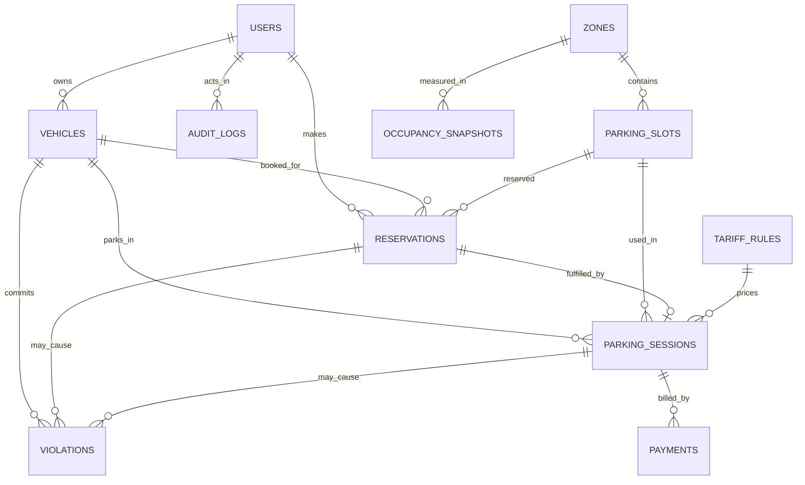

# ParkWise — Architecture

## 1. Principle
**The database is the brain.** Every rule that must never be broken lives in MySQL (constraints, triggers, procedures, functions). Flask is a thin layer that authenticates, validates input, and calls those procedures. The UI only displays and sends requests.

## 2. Layers

```
+---------------------------------------------------------------+
|  BROWSER  (HTML / CSS / JS / Bootstrap / Chart.js)           |
|  Pages: login, live board, find slot, reservations, entry/    |
|  exit, bill+pay, admin, analytics                             |
+------------------------------+--------------------------------+
                               |  JSON over HTTP  (fetch)
+------------------------------v--------------------------------+
|  FLASK APP  (Python)                                          |
|  - auth + sessions + role guard                               |
|  - input validation                                           |
|  - calls stored procedures / reads views (parameterised SQL)  |
|  - maps SQLSTATE 45000 messages -> HTTP 409/400 JSON          |
|  - SET @app_user_id on every admin request (for audit)        |
+------------------------------+--------------------------------+
                               |  mysql-connector-python (pool)
+------------------------------v--------------------------------+
|  MySQL 8  (InnoDB)  -- schema `parkwise`                      |
|                                                               |
|  TABLES (12)      FUNCTIONS (3)     PROCEDURES (12)           |
|  TRIGGERS (7)     VIEWS (9)         EVENTS (3)                |
|                                                               |
|  Events (scheduler):                                          |
|   every 1 min  -> sp_release_no_shows                         |
|   every 5 min  -> sp_flag_overstays                           |
|   every 15 min -> sp_take_snapshot                            |
+---------------------------------------------------------------+
        ^
        |  simulate.py (Member 2) calls the same Flask API:
        |  random cars/bikes enter, park, leave  ->  live demo + data
```

## 3. Where each piece of logic lives

| Concern | Layer | Object |
|---|---|---|
| Billing rule | MySQL | `fn_calc_amount`, `fn_billable_minutes` |
| Slot recommendation (scoring) | MySQL | `sp_recommend_slots` (weights in `system_settings`) |
| Double-booking prevention | MySQL | `sp_create_reservation` (row lock) + overlap check |
| One open session per slot / vehicle | MySQL | UNIQUE on generated columns in `parking_sessions` |
| Slot status sync (OCCUPIED / AVAILABLE) | MySQL | triggers `trg_sessions_ai`, `trg_sessions_au` |
| Reservation state machine | MySQL | trigger `trg_reservations_bu` |
| Eligibility (type, EV bay, accessible bay) | MySQL | `sp_assert_eligible` + `trg_sessions_bi` |
| No-show / overstay / snapshots | MySQL | events + `sp_*` jobs |
| Audit trail | MySQL | `trg_slots_au`, `trg_tariff_au`, `audit_logs` |
| Login, passwords, roles | Flask | werkzeug hashes, session cookie |
| Input validation, JSON, error mapping | Flask | route handlers |
| Rendering, charts, polling | Browser | JS |

## 4. Data model

### 4.1 ER diagram (Mermaid — renders in VS Code with a Mermaid preview extension, and on GitHub)



`system_settings` (key/value configuration) has no relationships on purpose.

### 4.2 Data dictionary

| Table | Purpose | Key columns / rules |
|---|---|---|
| `users` | Accounts | `email` UNIQUE, `role` USER/ADMIN, `password_hash` |
| `vehicles` | Registered vehicles | `reg_number` UNIQUE, `vehicle_type` TWO_WHEELER/CAR, `is_ev`, `has_accessible_permit`, FK owner |
| `zones` | Areas of the single lot | `zone_code` UNIQUE, `floor_level` |
| `parking_slots` | Physical slots | `slot_code` UNIQUE, `slot_type`, `is_ev_charger`, `is_accessible`, `is_premium`, `distance_to_entrance_m`, `status` AVAILABLE/OCCUPIED/MAINTENANCE |
| `tariff_rules` | Prices | per (vehicle_type, is_premium, effective_from); rate, grace, min charge, daily cap, overstay fine/hour; CHECKs |
| `reservations` | Future bookings | window `start_time < end_time` CHECK; status PENDING/ACTIVE/COMPLETED/NO_SHOW/CANCELLED; stores allocation score + reason |
| `parking_sessions` | Real stays | `active_slot_key` / `active_vehicle_key` (generated, UNIQUE) = one open session per slot and per vehicle; tariff frozen at entry; billing results stored at exit |
| `payments` | Payment attempts | PENDING/PAID/FAILED/REFUNDED; several rows per session allowed (retry after failure) |
| `violations` | Overstay, no-show, wrong slot, unauthorized bay | UNIQUE (session, type) and (reservation, type) so scheduler jobs cannot duplicate |
| `occupancy_snapshots` | History for forecast | per zone, per 15 min; UNIQUE (captured_at, zone) |
| `audit_logs` | Who changed what | JSON old/new values; actor from `@app_user_id` |
| `system_settings` | Tunable numbers | grace minutes, buffers, allocation weights, emission factor |

### 4.3 Normalization (talking points for Member 1)
- **1NF:** all columns atomic; no repeating groups (a vehicle's reservations live in their own table).
- **2NF:** every non-key attribute depends on the whole key. Tables use single-column surrogate keys, so there are no partial dependencies.
- **3NF:** no transitive dependencies. Vehicle details are not repeated in sessions, slot attributes are not repeated in reservations, and rates are not copied into sessions (only `tariff_id` is stored).
- **Deliberate denormalization (explain in the viva):** `parking_sessions.duration_minutes`, `billable_minutes`, `amount_due` are stored at exit. A bill is a historical fact and must not change when a tariff is edited later. `tariff_id` is frozen at entry for the same reason.

## 5. Concurrency design

```
User A  ----\                         /---- User B
             \                       /
          CALL sp_create_reservation(slot 5, same window)
                \                   /
                 v                 v
     1. START TRANSACTION
     2. SELECT ... FROM parking_slots WHERE slot_id=5 FOR UPDATE   <-- only ONE gets the lock
                                                                       the other WAITS here
     3. overlap check (locking read)   -> sees the winner's committed row
     4. INSERT reservation
     5. COMMIT   -> lock released -> the waiting call now fails with "Slot already booked"
```

- **Serialisation point:** the slot's row lock, taken first.
- **Locking reads for the overlap check:** under InnoDB's default REPEATABLE READ a plain `SELECT` could use an older snapshot and miss the winner's row; `FOR UPDATE` reads the latest committed data.
- **Entry:** the same slot-row lock plus UNIQUE keys on generated columns. Even a bug in the app cannot create two open sessions for one slot or one vehicle.
- **Proof:** `tests_concurrency.py` fires 5 simultaneous requests per round; exactly 1 must win, and the DB must contain 0 overlapping reservations.

## 6. Allocation algorithm (I1)

```
candidates = slots WHERE
      not under maintenance
  AND slot_type = vehicle_type
  AND (not accessible OR driver has permit)        -- hard constraint
  AND (not EV charger OR vehicle is EV)            -- hard constraint
  AND no overlapping PENDING/ACTIVE reservation in [start, end)
  AND (window starts later than walk-in buffer OR slot has no active session)

for each candidate (min-max normalised to 0..1):
  dist_score = 1 - (d - dmin) / (dmax - dmin)       (1 if all equal)
  ev_score   = is_ev_charger if vehicle is EV else 1
  acc_score  = is_accessible if driver has permit else 1
  cost_score = 1 if standard rate, 0 if premium

score = w_distance*dist + w_ev*ev + w_accessible*acc + w_cost*cost     (weights sum to 1.00)
default weights: 0.30 / 0.35 / 0.25 / 0.10  (system_settings)
return top 5 with a human-readable `reason` string
```

## 7. Scheduled jobs

| Event | Every | Procedure | Effect |
|---|---|---|---|
| `ev_release_no_shows` | 1 min | `sp_release_no_shows` | PENDING past `start + noshow_grace_minutes` becomes NO_SHOW and a violation row is added |
| `ev_flag_overstays` | 5 min | `sp_flag_overstays` | ACTIVE reserved sessions past booked end + grace get an OVERSTAY violation (final fine is set at exit) |
| `ev_occupancy_snapshot` | 15 min | `sp_take_snapshot` | One row per zone into `occupancy_snapshots` |

All three jobs are idempotent: running them twice creates no duplicates. Each can also be called by hand (`CALL sp_release_no_shows();`). This is the demo fallback if the event scheduler is off.

## 8. API contract (agree on this on day 1)

Base path `/api`. All bodies are JSON. Errors: `{"error": "<message from SIGNAL or validation>"}` with HTTP 400 (validation), 401/403 (auth), 409 (rule violated, e.g. slot already booked).

| Method + path | Role | Calls | Owner |
|---|---|---|---|
| `POST /auth/register`, `POST /auth/login`, `POST /auth/logout`, `GET /me` | public / any | `users` | M2 |
| `GET/POST /vehicles`, `PUT/DELETE /vehicles/<id>` | user | `vehicles` | M2 / M3 |
| `GET /slots` | any | `v_slot_live_status` | M2 |
| `GET /zones/occupancy` | any | `v_zone_occupancy` | M2 |
| `GET /recommend?vehicle_id&start&end` | user | `sp_recommend_slots` | M2 |
| `POST /reservations` | user | `sp_create_reservation` | M2 |
| `GET /reservations` | user | own rows | M2 |
| `DELETE /reservations/<id>` | user | `sp_cancel_reservation` | M2 |
| `POST /sessions/entry` | user/admin | `sp_vehicle_entry` (always pass `NULL` time) | M2 |
| `POST /sessions/<id>/exit` | user/admin | `sp_vehicle_exit` (always pass `NULL` time) | M2 |
| `GET /sessions/active` | any | `v_active_sessions` | M2 |
| `GET /bills/<session_id>`, `GET /bills/unpaid` | user/admin | `v_itemized_bill`, `v_unpaid_bills` | M2 |
| `POST /payments` | user | `sp_record_payment` | M2 |
| `GET/PUT /admin/tariffs`, `PUT /admin/slots/<id>/status`, `GET/POST /admin/violations`, `GET /admin/audit` | admin | tables, `sp_log_violation`, `audit_logs` | M2 |
| `GET /admin/users`, `PUT /admin/violations/<id>/status` | admin | `users`, `violations`, `audit_logs` | M3 |
| `GET /analytics/summary`, `/revenue`, `/hourly-demand`, `/forecast`, `/carbon` | admin | `v_daily_revenue`, `v_hourly_demand`, `v_occupancy_forecast`, `v_carbon_estimate` | M1 |

## 9. Folder structure

```
parkwise/
  db/            schema.sql  seed.sql  tests.sql  tests_concurrency.py        (M1)
  backend/
    app.py  config.py  db.py  auth.py  errors.py                              (M2)
    routes/  vehicles.py slots.py reservations.py sessions.py billing.py admin.py   (M2)
    routes/analytics.py                                                       (M1)
    simulate.py                                                               (M2)
  frontend/
    templates/ or static/  *.html  css/  js/                                   (M3)
  docs/          Architecture.md  Workflow.md  Decision.md  report/  slides/   (M3 + all)
  README.md
```

## 10. Security and quality rules
- Parameterised queries only (`cursor.execute(sql, params)`); never build SQL with f-strings.
- Passwords stored with `werkzeug.security.generate_password_hash`; never log them.
- Check the role in Flask on every admin route; regular users may only see their own vehicles, reservations and bills.
- The `p_entry_time` / `p_exit_time` parameters exist only for tests and the simulator; Flask must always pass `NULL` (Decision D-13).
- Flask normalises `reg_number` to uppercase with no spaces before any query.
- One DB connection per request from a pool; set `@app_user_id` on admin requests, then reset it.
- Use one time zone for DB and app (Decision D-14).
